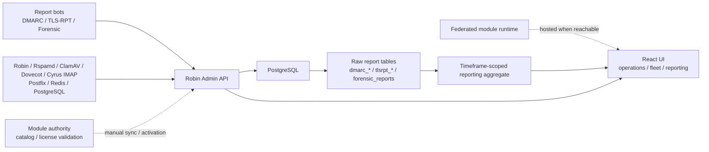

# Robin Admin


Robin Admin is a web interface for operating a Robin mail estate. It combines
mailbox administration, mail-service operations, fleet monitoring, report
analysis, modular extensions, access control, and audit logging in one console.

## What it covers

- **Mailboxes**: users, aliases, and auto aliases
- **Fleet operations**: service registry, health checks, aggregated metrics, and
  per-service views for Robin, Rspamd, ClamAV, Dovecot, Cyrus IMAP, Postfix, Redis, and PostgreSQL
- **Robin**: queue control, delivery tests, metrics, JSON5 configuration, and logs
- **Rspamd**: managed configuration, structured rules, DKIM key lifecycle, scan
  lab, classifier experiments, training corpus, metrics, and logs
- **ClamAV**: scan lab, bounded configuration, metrics, and logs
- **Postfix**: queue browser (view, hold/release, requeue, delete, deliver, flush), message-flow counters, bounded configuration, metrics, and logs via robin-agent
- **Cyrus IMAP**: agent-backed authentication and IMAP/LMTP metrics, sessions, mailbox lookup, quota, and logs; no configuration management
- **Dovecot**: live sessions with disconnect, mailbox lookup and quota, bounded configuration, metrics, and logs via robin-agent
- **Redis and PostgreSQL**: native metrics, bounded live configuration, operational controls, and conditional logs
- **Reporting intelligence**: overview, sending sources, domain conformance, and a record-level explorer
- **Raw evidence workspaces**: DMARC, TLS-RPT, and forensic report drill-down
- **Federated modules**: locally hosted module entrypoints with local license cache and runtime reachability checks
- **Administration**: administrators, API keys, security policy, integrations,
  reporting and ingestion settings, and activity history
- **Security controls**: brute-force protection, CSRF, IP allowlists, CORS origins, scoped API keys, and authenticated report ingestion

## Architecture



## Navigation model

- **Dashboard**: fleet-first landing page with throughput, protection pressure, attention, and capacity
- **Mailboxes**: mailbox administration
- **Fleet**:
  - Services and Metrics
  - Robin: queue, delivery test, metrics, config, and logs
  - Rspamd: scan, training, DKIM keys, rules, metrics, config, and logs
  - ClamAV: scan, metrics, config, and logs
  - Dovecot: metrics (sessions, quota), config, and logs
  - Cyrus IMAP: metrics (sessions, quota, mailbox lookup) and logs
  - Postfix: queue, metrics, config, and logs
  - Redis and PostgreSQL: metrics, config, operational controls, and logs when available
- **Monitoring**: external checks, status-page management, and email-delivery monitoring
- **Telemetry**: host and service metrics pushed by Vector into VictoriaMetrics, with dashboards built and edited in the UI and PromQL Explore
- **Reports**:
  - Intelligence: Overview, Sources, Domains, Explorer
  - Raw evidence: DMARC Raw, TLSRPT Raw, Forensic Raw
- **Modules**: local module catalog, runtime status, and paid-module activation
- **Administration**: access, security, integrations, reporting, and activity log

Navigation is feature- and role-aware. Unavailable integrations and
unauthorized administrative actions are hidden.

## Quick start

### Prerequisites

- Node.js 22.22.2+, 24.15+ or 26+
- PostgreSQL (a dedicated Robin Admin database is supported)
- Robin MTA is optional; MTA-specific controls remain unavailable until it is configured

### Development

The development server connects to PostgreSQL on `localhost:5432` with user,
password and database `robin` unless the `DB_*` variables say otherwise, and
needs an encryption key for the secrets it stores (32 or more characters). One
way to get a database:

```bash
docker run -d --name robin-admin-dev-db -p 127.0.0.1:5432:5432   -e POSTGRES_USER=robin -e POSTGRES_PASSWORD=robin -e POSTGRES_DB=robin postgres:16
```

Then:

```bash
git clone https://github.com/transilvlad/robin-admin.git
cd robin-admin
npm run install:all
export ROBIN_ADMIN_ENCRYPTION_KEY="$(openssl rand -hex 32)"
npm run dev
```

Keep the same key between runs: secrets stored with one key cannot be read with
another. Every setting is described in the
[configuration reference](doc/configuration.md).

- Frontend: `http://localhost:5173`
- Backend API: `http://localhost:3000`

The frontend uses Tailwind CSS 4 through its Vite plugin. Theme tokens, shared
controls and class-based dark mode live in `client/src/styles/globals.css`;
source detection is restricted to the client directory. `npm run build:client`
also checks the compiled stylesheet for theme, responsive and control rules.
Supported browsers are Chrome/Edge 111+, Firefox 128+ and Safari 16.4+.
Hosted modules keep their own styles isolated inside Shadow DOM.

### First-time setup

On first boot, the server writes a setup ID to a local `0600` server file
while setup is pending, and also logs where the file was written:

```text
[SETUP] Setup ID file: /tmp/robin-admin-setup-id
```

Root can retrieve it with `cat /tmp/robin-admin-setup-id`, or in the bundled
Compose deployment with `docker exec suite-admin cat /tmp/robin-admin-setup-id`.
Set `SETUP_ID_FILE` to use a different server-local path.

Open the UI, complete the setup wizard, then log in. Browser authentication is **session-cookie based** (`express-session` with PostgreSQL storage). Automations should use scoped API keys created in **Administration -> Access**.

After first login, review **Administration -> Security / Integrations / Reporting** for:

- Login lockout and session lifetime policy
- CSRF protection
- Global and ingestion CIDR allowlists
- CORS origins
- API keys for automations
- Report ingestion CIDRs and shared secret under **Reporting**
- Reports integration enablement and optional DNS posture checks
- Fleet, Monitoring, Telemetry, and Modules capability switches under **Administration -> Integrations -> Capabilities**
- Module installer signing, proxy secrets, and catalogue root-key status before enabling Modules
- Shared avatar defaults and the Robin config-store table under **Administration -> Integrations**

Rspamd connectivity, credentials, and managed paths are configured per service
under **Fleet -> Services**. For a container deployment, mount the service's
configuration and state into `suite-admin`:

```yaml
services:
  suite-admin:
    volumes:
      - /host/path/to/rspamd/local.d:/mnt/rspamd/local.d
      - /host/path/to/rspamd/store:/mnt/rspamd/store
```

The suite overlay (`docker-compose.suite.yaml`) defaults these host paths to
the sibling Robin suite.
Override them with `RSPAMD_CONFIG_MOUNT` and `RSPAMD_STORE_MOUNT`. Rspamd remains
an independent fleet service; it does not depend on Robin being enabled.

### Docker

Robin Admin runs as a Compose stack that follows the Robin suite conventions:
every container is named `suite-<component>` and other services are reached by
role alias (`postgres-backend`, `mta-backend`, `metrics-backend`, ...), never
by container name.

| Container | Role alias | Purpose |
|-----------|------------|---------|
| `suite-admin-gateway` | `admin-gateway` | HTTPS entrypoint (Caddy); routes `/api`, `/health`, `/modules` to the server and everything else to the UI |
| `suite-admin` | `admin-backend` | API server |
| `suite-admin-ui` | `admin-frontend` | Static UI |
| `suite-admin-postgres` | `postgres-backend` (private) | Robin Admin's database (standalone stack) |
| `suite-victoriametrics` | `metrics-backend` (private) | Bundled telemetry store |
| `suite-admin-installer` | `installer-backend` (private) | Module installer (profile `installer`) |
| `suite-admin-agent` | none | Co-located agent for the suite's containers (suite overlay) |

Layouts are Compose files combined with the base `docker-compose.yaml`:

| Layout | Command | Use |
|--------|---------|-----|
| Standalone | `docker compose up -d` | Robin Admin alone, with its own database |
| Robin suite | `docker compose -f docker-compose.yaml -f docker-compose.suite.yaml up -d` | Joins the Robin suite (`suite` network): suite database, Robin MTA, modules and the co-located agent |
| Host-networked | `docker compose -f docker-compose.yaml -f docker-compose.host.yaml up -d` | A mail host whose services listen on loopback, behind the host's own reverse proxy |
| Development | add `-f docker-compose.dev.yaml` to any layout | Builds from source; optional `telemetry-dev`, `agent-dev` and `postfix-dev` profiles |

```bash
cp .env.example .env
# Set SESSION_SECRET, ROBIN_ADMIN_ENCRYPTION_KEY, DB_PASSWORD and
# ROBIN_ADMIN_PUBLIC_URL (and the suite overlay's settings when using it).
docker compose up -d
docker exec suite-admin cat /tmp/robin-admin-setup-id
```

Default HTTPS entrypoint: `https://localhost:3443` (`ADMIN_HTTPS_PORT`).

The telemetry store is part of the stack: enable Telemetry and it works with no
further configuration (see [Telemetry](doc/telemetry.md)). The server refuses to
start in production with missing or default secrets.

For the Robin suite, start the suite first (`docker compose -f
.suite/docker-compose.yaml up -d` in the Robin repository), then Robin Admin
with the suite overlay, then the modules.

### Standalone path-prefix deployment

Robin Admin can be hosted independently of Robin MTA and optional module services at a path such
as `https://admin.example.com/admin`. It needs a dedicated PostgreSQL
database and persistent database volume, not another service's database. The
one UI image serves any prefix: set `BASE_PATH=/admin/` at runtime. See
[Standalone deployment](doc/standalone-deployment.md) for the environment
variables and Caddy `handle_path` rules.

### Optional module services

Robin Admin does not start optional modules such as `robin-tools`; each
module's Compose file joins the Robin suite network as `suite-<module>` and
`suite-<module>-ui` (aliases `<module>-backend` and `<module>-frontend`).
Enable **Modules** under **Administration -> Integrations** after the catalogue
root key, module proxy secrets, and host-installer signing secret are in place.

Deploy optional modules separately using their own deployment documentation.
Robin Admin does not require local checkouts of those repositories or a
particular directory layout.

- `robin-tools` provides `suite-tools-ui` and `suite-tools`.
- `robin-tools` is shown in Robin Admin only when its runtime is reachable.

Runtime readiness uses credential-free `HEAD` requests to the installed module's
health URL. A slow start, connection failure, or HTTP 408/425/429/502/503/504 gets
one retry: each attempt has a three-second deadline with a 250 ms delay between
attempts (at most 6.25 seconds for the probe). Concurrent callers share the same
check. Successful results are cached for ten seconds and failures for two;
authentication errors, missing routes and redirects fail without a retry.
Readiness does not replace identity verification or licence validation, and a
backend health response alone does not verify the frontend or every module operation.
- The configured catalogue and licensing authority handles manual **Update modules**,
  license activation, and scheduled renewal. There is no automatic authority failover.
- Paid modules use signed, instance-bound leases lasting at most 24 hours. During
  a temporary authority outage, a cached lease remains usable until its signed
  expiry, followed by up to 72 hours of signed offline grace. An explicit
  rejection disables access immediately, including offline grace.
- The module list shows the issuing authority, deployment, last successful
  validation, and cached lease state. Its renewal control validates immediately.
- Robin Admin proxies browser module API traffic to sibling module backends and
  mounts hosted module frontends inside a Shadow DOM host to isolate styles.
- The configured catalog/license endpoint is a hosted
  service operated by the Robin Admin maintainer, used for the module catalog,
  license activation, and update checks. Robin Admin runs fully without it
  (`ROBIN_API_ENABLED`/module features simply stay unlicensed or offline).
  License activation sends the license key, instance ID/fingerprint, public key,
  deployment hostname, and app version to that authority. Renewal sends a
  proof-of-possession signature and key-bound refresh credential. Renewal keeps
  that credential retryable if a response is lost; explicit reactivation replaces
  it. Catalogue
  access and optional anonymous purchase-link clicks also contact that authority.

## Reporting model

Robin Admin keeps two reporting layers side by side:

1. **Raw evidence** for RFC-level inspection of imported DMARC, TLS-RPT, and AFRF/forensic reports.
2. **Reporting intelligence** for operator workflows such as posture review, incident triage, sender inventory, TLS posture, and remediation.

The raw-report pages support persistent filters, server-side sorting, and
evidence modals; the intelligence pages focus on actionable issues and current
posture. Reports navigation and workspaces can be hidden under
**Administration -> Reporting** without deleting stored reports or changing
report-ingestion authentication. See [Reports](doc/reports.md).

## Database schema

Robin Admin owns its PostgreSQL schema and ensures it on startup: the server
runs the authoritative `CREATE TABLE IF NOT EXISTS` / `CREATE INDEX IF NOT
EXISTS` definitions in `server/src/db/schema.ts` on every boot, so a fresh
database is provisioned automatically; populated databases keep their data.

## Documentation map

- [Documentation index](doc/README.md)
- [Getting started](doc/getting-started.md)
- [Dashboard](doc/dashboard.md)
- [Mailboxes](doc/mailboxes.md)
- [Authentication and security](doc/authentication.md)
- [Reports](doc/reports.md)
- [API reference](doc/api.md)
- [Fleet](doc/fleet.md)
- [Fleet service capabilities](doc/fleet-service-capabilities.md)
- [Telemetry](doc/telemetry.md)
- [Robin](doc/robin.md)
- [Administration](doc/management.md)
- [Module protocol](doc/module-protocol.md)
- [Fleet configuration agent](agent/README.md)
- [Agent deployment guide](doc/agent-deployment.md)
- [Agent co-location guide](doc/agent-co-location.md)
- [Host module installer](installer/README.md)
- [Standalone path-prefix deployment](doc/standalone-deployment.md)

## Scripts

```bash
# App
npm run dev
npm run build
npm test

# Server only
npm run test:server

# Client only
npm run test:client
```

## Release validation

For release artifact validation, manually run the **Release** workflow on the
selected branch. It runs CI, verifies package versions, and uploads archives and
checksums without creating a GitHub Release or publishing images. Pushing a
matching `v*` tag remains the explicit publication action.

Image workflows refresh the `runtime` stage's OS packages on every build while
retaining dependency and compilation caches. For a local security refresh, use
`docker buildx build --no-cache-filter runtime --load -t robin-admin-client ./client`
(replace `client` with `server` for the API). Inspect the image scan result before
deploying its immutable digest; a successful application build is not a passed
runtime security scan.

## Security

- Admin passwords are hashed with bcrypt
- Sessions are persisted server-side in PostgreSQL
- Browser writes use CSRF tokens
- Login attempts are persisted and can trigger account/IP lockouts
- Automations use scoped, hashed, revocable API keys
- API keys can expire and can be restricted by CIDR
- Report ingestion requires a `reports:ingest` API key or shared ingestion secret from every source by default; trusted producer CIDRs (e.g. co-located local/container networks) can be added explicitly under **Administration -> Reporting**
- Global and ingestion-specific IP restrictions are configurable
- Rspamd integration is enabled independently from Robin when its controller is reachable and its mounts are readable
- Production CORS should use explicit allowed origins
- Admin actions are audited

## License

Apache 2.0 - See [LICENSE](LICENSE)

- [Contributing](contributing.md)
- [Code of conduct](code_of_conduct.md)
