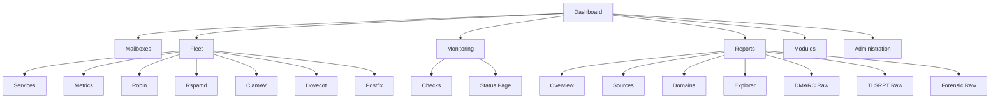

# Robin Admin documentation

This guide covers installation, operation, security, service integrations,
reporting, fleet management, modules, and the public API.

## Documentation map

1. [Getting started](getting-started.md)
2. [Authentication](authentication.md)
3. [Dashboard](dashboard.md)
4. [Mailboxes](mailboxes.md)
5. [Robin MTA](robin.md)
6. [Fleet management](fleet.md)
7. [Reports](reports.md)
8. [Monitoring and status page](monitoring.md)
9. [Administration](management.md)
10. [API Reference](api.md)
11. [Operational alerting](alerting.md)
12. [Fleet service capabilities](fleet-service-capabilities.md)
13. [Module protocol](module-protocol.md)
14. [Fleet configuration agent](../agent/README.md)
15. [Agent deployment guide](agent-deployment.md)
16. [Agent co-location guide](agent-co-location.md)
17. [Host module installer](../installer/README.md)
18. [Telemetry](telemetry.md)
19. [Configuration reference](configuration.md)

## Product map

## Quick start

1. Open Robin Admin at `https://localhost:3443`
2. If no admin exists yet, have the server root user read the setup ID from `SETUP_ID_FILE`, then complete the setup wizard
3. Sign in with your admin account
4. Use the sidebar to move between Mailboxes, Fleet, Monitoring, Reports, Modules, and Administration

## Platform notes

- Auth is **session-cookie based**, backed by PostgreSQL via `express-session`
- Automations use **scoped API keys**, configured from Administration -> Access
- Browser writes use CSRF tokens; report ingestion requires a scoped key or shared ingestion secret by default
- The dashboard is **fleet-first**, not queue-first
- Service webhook alerts are configured under **Administration → Alerts**
- Robin, Rspamd, ClamAV, Dovecot, Postfix, Redis, and PostgreSQL are service-specific workspaces
  nested under **Fleet**
- Federated modules are **deployment-local** and appear in hosted navigation only when their runtime is reachable
- `Robin Tools` is a free federated diagnostics module
- The module licensing authority is **optional at boot**. Catalogue sync, license activation and
  scheduled entitlement renewal contact the explicitly configured authority.
  A failed renewal retains verified cached metadata and follows the lease/grace policy.
- Reporting is split into **raw evidence** and **operator intelligence**; its navigation and workspaces can be hidden from **Administration -> Integrations -> Capabilities** without deleting stored reports or changing ingestion authentication
- The repository includes both **server** and **client** Vitest suites
- The server runs its metrics poller, alert scheduler/delivery worker, and Rspamd
  DKIM maintenance as **singleton background jobs**. If more than one server
  replica is ever run (e.g. for zero-downtime deploys), a Postgres advisory
  lock (`server/src/services/leader-lock.ts`) elects exactly one replica to
  run them; the rest serve HTTP/API traffic only. A single replica always
  acquires the lock immediately, so this has no effect on the common
  single-instance deployment.
- Both the bundled Caddy (`caddy/Caddyfile`) and the standalone client Nginx
  image (`client/nginx.conf`) compress text-based responses (`encode zstd
  gzip` / `gzip on`) to reduce bandwidth for the SPA bundle and JSON API
  payloads.
- `admin_audit_log` retention uses the same operator controls as raw-report
  retention: an **Audit log retention (days)** setting under
  **Administration -> Security** (`0` by default, keeping entries
  indefinitely) plus an on-demand cleanup action.
- The raw DMARC tables are partitioned by month: `dmarc_reports` on
  `date_begin` and `dmarc_records` on `report_day` (the report's start date),
  so a report and its records always share a month. Ingest creates the month
  partitions it needs, and retention (`reportingRetentionDays`, 365 days by
  default) drops whole months from both tables once they are past the window,
  which frees disk immediately with no `DELETE` or `VACUUM`. Reporting reads
  come from the permanent rollups, so pruning raw months never changes the
  reported numbers.
