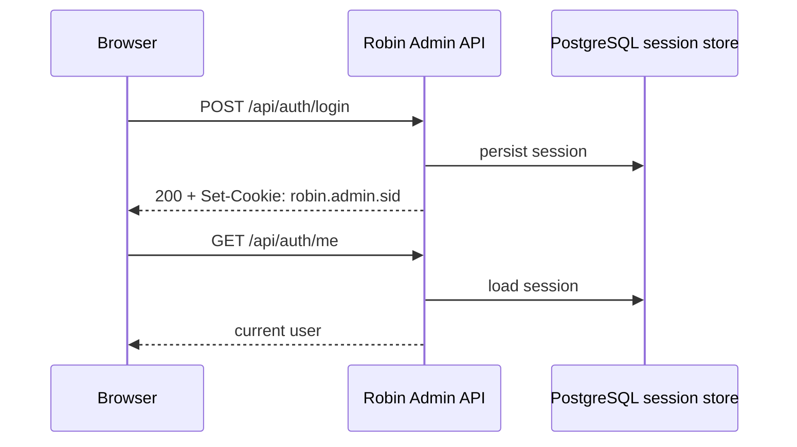

# API reference

Robin Admin exposes a REST API under:

```text
https://localhost:3443/api
```

## Authentication model

Browser users authenticate with a **server-side session cookie**. Automations should use scoped API keys.



Key endpoints:

| Method | Path | Description |
|--------|------|-------------|
| POST | `/auth/login` | Sign in and establish session |
| POST | `/auth/logout` | Destroy current session |
| GET | `/auth/me` | Return current authenticated admin |
| GET | `/auth/csrf` | Return the current session CSRF token |
| GET | `/setup/status` | Check whether first-time setup is required |
| POST | `/setup` | Create the first admin account |

Health checks are outside the `/api` prefix:

| Method | Path | Description |
|--------|------|-------------|
| GET | `/health/live` | Process liveness |
| GET | `/health/ready` | PostgreSQL-backed readiness |

### Browser write requests

Cookie-authenticated `POST`, `PUT`, `PATCH`, and `DELETE` requests require:

```text
X-CSRF-Token: <token>
```

The token is returned by `POST /auth/login` and can be refreshed with `GET /auth/csrf`.

### Automation authentication

API keys use:

```text
Authorization: Bearer <api-key>
```

Keys are managed from **Administration -> Access** or the admin-only API-key endpoints. Keys are scoped and still have a role ceiling.

| Method | Path | Description |
|--------|------|-------------|
| GET | `/api-keys` | List API key metadata |
| POST | `/api-keys` | Create an API key and return the one-time plaintext secret |
| POST | `/api-keys/:id/revoke` | Revoke an API key |
| DELETE | `/api-keys/:id` | Delete an API key record |
| GET | `/security/ip-jail` | List IP jail entries (`includeInactive=true` optional) |
| POST | `/security/ip-jail` | Create IP/CIDR jail entry |
| PUT | `/security/ip-jail/:id` | Update jail expiry (`expiresAt`, nullable for infinite) |
| POST | `/security/ip-jail/:id/lift` | Lift an active jail entry |

Example create request:

```json
{
  "name": "metrics exporter",
  "role": "viewer",
  "scopes": ["metrics:read"],
  "allowedCidrs": "198.51.100.10/32",
  "expiresAt": "2026-12-31"
}
```

Example response includes `data.plainText` once. Store it immediately; it cannot be recovered later.

Common scopes:

| Scope | Use |
|-------|-----|
| `users:read`, `users:write` | Mail user API |
| `aliases:read`, `aliases:write` | Alias API |
| `queue:read`, `queue:write` | Queue API |
| `mail:send` | Send email API |
| `fleet:read`, `fleet:write` | Fleet services API |
| `metrics:read` | Metrics and dashboard reads |
| `reporting:read`, `reporting:write` | Reporting intelligence API |
| `reports:read`, `reports:ingest` | Raw report reads and ingestion |
| `telemetry:read`, `telemetry:write`, `telemetry:manage` | Telemetry reads, metric ingestion and dashboard changes ([Telemetry](telemetry.md)) |
| `audit:read` | Audit log reads |
| `admin:*` | Admin-only settings, admins, config, and API-key management |

## Response shape

```json
{
  "success": true,
  "data": {},
  "pagination": {}
}
```

Errors:

```json
{
  "success": false,
  "error": "Error message"
}
```

## Core operational endpoints

| Area | Representative endpoints |
|------|--------------------------|
| Users | `GET /users`, `POST /users`, `PUT /users/:id`, `DELETE /users/:id` |
| Aliases | `GET /aliases`, `POST /aliases`, `PUT /aliases/:id`, `DELETE /aliases/:id` |
| Auto aliases | `GET /auto-aliases`, `POST /auto-aliases`, `PUT /auto-aliases/:id`, `DELETE /auto-aliases/:id` |
| Queue | `GET /queue`, `GET /queue/stats`, `POST /queue/retry/:uid`, `POST /queue/delete/:uid`, `POST /queue/bounce/:uid` |
| Robin metrics | `GET /metrics/live`, `GET /metrics/history`, `GET /metrics/raw`, `GET /metrics/stats` |
| Robin config | `GET /robin-config/files`, `GET /robin-config/server-ids`, `GET /robin-config/file/:fileName?serverId=`, `PUT /robin-config/:serverId/:fileName`, `DELETE /robin-config/:serverId/:fileName`, `POST /robin-config/reload` |
| Dashboard | `GET /dashboard`, `GET /dashboard/fleet` |
| Fleet | `GET /fleet/services`, `GET /fleet/services/enabled`, `GET /fleet/services/:serviceId` plus create/update/delete and health checks |
| Fleet capabilities | `GET /fleet/capabilities` (per service: each feature's `available` and `reason`; per type: what any enabled service can do), `GET /fleet/capabilities/matrix` (the same rules for every setup, for Fleet → Docs) |
| Fleet sync | `GET /fleet/services/:serviceId/sync`, `POST /fleet/services/:serviceId/sync/request`, and agent manifest/file/status routes (agent-credential auth) |
| Telemetry alert issues | Admin-only `GET /telemetry-alert-issues[?status=&limit=&offset=]`, `GET /telemetry-alert-issues/:id`, `POST /telemetry-alert-issues/:id/dismiss` and `/resume`; mutations require `expectedRevision`, return `409` for stale state, and are CSRF-protected |
| Fleet agent channel | `GET /fleet/agent/commands?actions=&ack=` (agent long-poll for queued actions; `ack` lists the previous poll's command ids), `POST /fleet/agent/commands/:commandId/result`, plus enroll/heartbeat/metrics/logs pushes — agent-credential auth |
| Modules | Catalog, activation, installation lifecycle, runtime status, and authenticated module-backend proxy routes |
| Rspamd | `GET /rspamd/status`, `GET/PUT /rspamd/settings`, `GET/PUT /rspamd/config`, `GET /rspamd/config/scopes`, `PUT/DELETE /rspamd/config/files/:key`, `POST /rspamd/reload`, `GET /rspamd/rules`, `POST /rspamd/rules/preview`, `PUT /rspamd/rules`, `GET/PUT /rspamd/classifiers`, `POST /rspamd/scan`, `POST /rspamd/scan-file`, `GET /rspamd/scans`, `GET /rspamd/scans/:id`, `POST /rspamd/scans/:id/replay`, `POST /rspamd/scans/:id/learn`, `POST /rspamd/scans/:id/fuzzy`, DKIM domain/selector endpoints, training corpus endpoints |
| ClamAV | `GET /clamav/status`, `GET/PUT /clamav/config`, `GET /clamav/config/scopes`, `DELETE /clamav/config/files/:key`, `GET /clamav/config/rendered`, `POST /clamav/reload`, `POST /clamav/scan` |
| Dovecot | `GET/PUT /dovecot/config`, `PUT/DELETE /dovecot/config/files/:key`, `GET /dovecot/config/scopes`, `GET /dovecot/config/rendered`, `POST /dovecot/reload`, `GET /dovecot/sessions`, `POST /dovecot/sessions/kick` `{user}`, `GET /dovecot/quota`, `GET /dovecot/users/:user` |
| Postfix | `GET/PUT /postfix/config`, `PUT/DELETE /postfix/config/files/:key`, `GET /postfix/config/scopes`, `GET /postfix/config/rendered`, `POST /postfix/reload`, `POST /postfix/flush`, `GET /postfix/queue`, `GET /postfix/queue/:queueId`, `POST /postfix/queue/actions` `{action: hold\|release\|requeue\|delete, queueIds}`, `POST /postfix/queue/:queueId/deliver` |
| Redis | `GET/PUT/DELETE /redis/config`, `GET /redis/config/scopes`, `GET /redis/config/rendered`, `POST /redis/reload`, slowlog/clients/bgsave/bgrewriteaof/stats-reset ops |
| Postgres | `GET/PUT/DELETE /postgres/config`, `GET /postgres/config/scopes`, `GET /postgres/config/rendered`, `POST /postgres/reload`, activity/locks/vacuum/analyze/stat-statements ops |
| MariaDB | `GET/PUT/DELETE /mariadb/config`, `GET /mariadb/config/scopes`, `GET /mariadb/config/rendered`, `POST /mariadb/reload` (re-apply), `GET /mariadb/processes`, `POST /mariadb/processes/kill` `{id, scope: query\|connection}`, `GET /mariadb/transactions`, `GET /mariadb/schemas`, `GET /mariadb/tables?schema=`, `POST /mariadb/analyze` `{table: schema.table}`, `GET /mariadb/statements`, `POST /mariadb/stats/reset` |
| Logs | `GET /logs?serviceType=...&serviceId=...` |

Fleet-service config endpoints share the per-instance override model: `?serviceId=`
selects the scope (`default` is the shared base; any other id is a per-instance
override that stores only its delta). `GET .../config/scopes` lists the scopes;
`DELETE` (`.../config` for redis/postgres/mariadb, `.../config/files/:key` for the
file-based services) resets an instance's override back to the base.

Postfix, Dovecot and Rspamd runtime actions (queue, sessions, quota, reload,
flush) run on the service's host through its robin-agent. `GET /fleet/capabilities`
says which a service's setup supports, and actions fail with `400` when no agent
can run them.

## Modules endpoints

Robin Admin keeps module install state and paid-module lease cache locally. The configured licensing authority is contacted for manual catalog sync, license activation, and scheduled renewal.

| Method | Path | Description |
|--------|------|-------------|
| GET | `/modules` | List merged module state for the UI, including local install metadata, activation state, and runtime availability |
| GET | `/modules/:slug` | Return one merged module view |
| POST | `/modules/sync` | Admin-only manual catalog refresh from the configured authority |
| POST | `/modules/:slug/activate` | Admin-only license activation against the configured authority |
| POST | `/modules/:slug/install` | Install a policy-approved module version |
| POST | `/modules/:slug/upgrade` | Upgrade a module through the host installer |
| POST | `/modules/:slug/start` | Start an installed module |
| POST | `/modules/:slug/stop` | Stop an installed module |
| POST | `/modules/:slug/uninstall` | Remove module containers while preserving named volumes |
| GET | `/modules/:slug/status` | Return host-installer status |
| GET | `/modules/:slug/jobs/:jobId` | Poll an installation lifecycle job |
| Various | `/modules/:slug/*` | Proxy authenticated requests to an active module backend |

Module responses include these runtime fields in addition to the catalog/install/license fields:

```json
{
  "runtimeAvailable": true,
  "runtimeStatus": "reachable",
  "runtimeMessage": "Module runtime is reachable."
}
```

- Hosted module navigation should only be shown when `active` is `true` and `runtimeAvailable` is `true`.
- If the authority is down, `GET /modules` still returns cached local state; catalog sync, activation, and renewal requests fail.
- Robin Admin proxies active module API traffic to the configured sibling backend.
  Browser traffic stays same-origin; Robin Admin remains the authentication and
  CSRF boundary.

## Configuration endpoints

| Method | Path | Description |
|--------|------|-------------|
| GET | `/config/reporting-usage` | Return raw DMARC, TLSRPT, and forensic report counts, date ranges, and storage usage |
| POST | `/config/cleanup-reporting` | Delete raw DMARC, TLSRPT, and forensic reports older than the configured reporting retention window |

## Security settings endpoints

Security policy is exposed through the existing config API. Admin-only writes require the `admin:*` API-key scope or an admin browser session.

| Method | Path | Description |
|--------|------|-------------|
| GET | `/config` | Return visible settings; admins receive security settings too |
| PUT | `/config` | Update settings such as login protection, CSRF, IP allowlists, CORS origins, ingestion policy, and API-key max lifetime |
| POST | `/config/ingestion-secret` | Rotate the shared report-ingestion secret |
| POST | `/config/clear-login-locks` | Clear active login lockouts for one email or all emails |

IP jail enforcement happens before auth checks and applies to all `/api` endpoints.

## Rspamd endpoints

Rspamd is managed as an isolated integration. Availability depends on readable mounts plus a reachable controller, not on Robin.

| Method | Path | Description |
|--------|------|-------------|
| GET | `/rspamd/status` | Runtime status for controller ping/health/auth, normal-worker ping, Robin signing-query sync, and mount readability/writability |
| GET | `/rspamd/settings` | Return control-plane settings (enable flag, Robin query sync, URLs, paths, and `hasControllerPassword` / `hasEnablePassword`; the passwords themselves are write-only) and current status |
| PUT | `/rspamd/settings` | Update Rspamd enablement, Robin query sync, controller URLs, and mount paths; send `rspamdControllerPassword` / `rspamdEnablePassword` to set a password, `""` to clear it, or leave it out to keep it |
| GET | `/rspamd/config` | Return managed DKIM/Bayes policy plus per-file managed/unmanaged state |
| PUT | `/rspamd/config` | Update managed DKIM/Bayes policy and per-file management toggles for `dkim_signing.conf` and `classifier-bayes.conf` |
| GET | `/rspamd/rules` | Return the structured rules document, per-family management toggles, validation state, and rendered file previews |
| POST | `/rspamd/rules/preview` | Validate and render a draft rules document without persisting it |
| PUT | `/rspamd/rules` | Persist the structured rules document and write generated `actions.conf`, `groups.conf`, `settings.conf`, `composites.conf`, `multimap.conf`, and managed `maps/*.map` files |
| GET | `/rspamd/classifiers` | Return scan-lab defaults, fuzzy presets, controller reachability, and discovered statfile/classifier status |
| PUT | `/rspamd/classifiers` | Update default scan transport, optional classifier override, and fuzzy presets |
| POST | `/rspamd/scan` | Scan a raw RFC822 message with optional outbound metadata (`envelopeFrom`, `recipients`, `clientIp`, `helo`, `hostname`, `authenticatedUser`, `settingsId`, `queueId`) |
| POST | `/rspamd/scan-file` | Scan one uploaded RFC822 message as `application/octet-stream`; metadata can be supplied in the `X-Rspamd-Scan-Metadata` JSON header |
| GET | `/rspamd/scans` | List persisted scan history for the selected Rspamd service |
| GET | `/rspamd/scans/:id` | Return one stored scan run, its raw message, full JSON result, and follow-up actions |
| POST | `/rspamd/scans/:id/replay` | Replay one stored scan with the original message, metadata, and transport |
| POST | `/rspamd/scans/:id/learn` | Learn one stored scan as `spam` or `ham`; `classifier` is optional |
| POST | `/rspamd/scans/:id/fuzzy` | Add or remove one stored scan from fuzzy storage using a preset or explicit `flag`/`weight` |
| GET | `/rspamd/dkim/domains` | List DKIM domains with active selector metadata |
| POST | `/rspamd/dkim/domains` | Create DKIM domain policy |
| PUT | `/rspamd/dkim/domains/:id` | Update domain, signing domain, and rotation policy |
| GET | `/rspamd/dkim/domains/:id/selectors` | List selector history for one domain |
| POST | `/rspamd/dkim/domains/:id/keys` | Create the initial selector for a domain |
| POST | `/rspamd/dkim/domains/:id/rotate` | Rotate to a new active selector |
| POST | `/rspamd/dkim/selectors/:id/revoke` | Revoke a non-active selector |
| POST | `/rspamd/training/import-file?label=spam&fileName=batch.tar.gz&serviceId=...` | Upload one raw `.eml`, `.mbox`, `.zip`, `.tar`, `.tar.gz` or `.tgz` as `application/octet-stream`; its messages are stored and learned |
| GET | `/rspamd/training/imports/:id` | Fetch one import job |
| GET | `/rspamd/training/samples` | List stored training samples with `page`, `limit`, `label`, `status`, and `search` filters |
| GET | `/rspamd/training/samples/:id` | Fetch one stored sample |
| POST | `/rspamd/training/samples/:id/learn` | Relearn one stored sample with its current label |
| POST | `/rspamd/training/samples/:id/relabel` | Change label (`spam`/`ham`) and relearn |
| DELETE | `/rspamd/training/samples/:id` | Delete a stored sample and its file |

### Rspamd scan example

`POST /api/rspamd/scan`

```json
{
  "serviceId": "rspamd-core",
  "transport": "checkv2",
  "rawMessage": "From: sender@example.com\nTo: user@example.net\nSubject: test\n\nHello world\n",
  "envelopeFrom": "bounce@example.com",
  "recipients": ["user@example.net"],
  "clientIp": "203.0.113.10",
  "helo": "mail.example.com",
  "authenticatedUser": "customer-42",
  "settingsId": "outbound-customer"
}
```

### Rspamd training import example

```json
{
  "label": "spam",
  "files": [
    {
      "name": "batch.zip",
      "contentBase64": "<base64-data>"
    }
  ]
}
```

### Larger raw upload example

```text
POST /api/rspamd/training/import-file?label=spam&fileName=batch.tar.gz
Content-Type: application/octet-stream
X-CSRF-Token: <token>
```

Body: raw file bytes

### Managed DKIM selector behavior

- Selector format is date-first: `20260504`, then `20260504a`, `20260504b`, etc.
- PostgreSQL stores selector metadata, public key material, state, retention timestamps, and the private key, encrypted with `ROBIN_ADMIN_ENCRYPTION_KEY`.
- The fleet agent delivers each enabled domain's active key to `local.d/dkim/<domain>.<selector>.key`, and `dkim_signing.conf` gains a `domain { }` block naming it. A rotation reaches Rspamd on the agent's next sync.
- Retired keys are kept for the domain's retention window, then deleted from the database.
- Keys are delivered only when `dkim_signing.conf` is managed and an agent applies Rspamd config; over an ssh exec prefix the agent cannot deliver files.
- Rules management persists one service-scoped structured document and renders managed files server-side before save.
- Robin's own `rspamd.json5` stays under **Fleet -> Robin -> Config** as a
  Robin-owned file.
- Fleet Services owns Rspamd service registration and endpoints; the Rspamd workspace owns managed files, metrics, and training.

## Raw reporting endpoints

These endpoints ingest or browse raw evidence. Ingestion endpoints accept requests from an explicitly configured trusted-ingestion-CIDR allowlist, which is empty by default — no source is trusted without a credential until an operator opts one in under **Administration -> Reporting**. A common opt-in for co-located deployments is localhost and common local/container networks:

```text
127.0.0.0/8
::1/128
10.0.0.0/8
172.16.0.0/12
192.168.0.0/16
fc00::/7
```

Requests from source IPs not on that list require either `reports:ingest` API-key scope or:

```text
X-Robin-Admin-Ingest-Secret: <shared-secret>
```

### DMARC

| Method | Path | Description |
|--------|------|-------------|
| POST | `/dmarc/reports` | Ingest DMARC aggregate report |
| GET | `/dmarc/reports` | List raw reports |
| GET | `/dmarc/reports/:id` | Get one raw report |
| GET | `/dmarc/stats` | Summary counters |
| GET | `/dmarc/chart` | Chart data for the raw workspace |

### TLS-RPT

| Method | Path | Description |
|--------|------|-------------|
| POST | `/tlsrpt/reports` | Ingest TLS-RPT report |
| GET | `/tlsrpt/reports` | List raw reports |
| GET | `/tlsrpt/reports/:id` | Get one raw report |
| GET | `/tlsrpt/stats` | Summary counters |
| GET | `/tlsrpt/chart` | Chart data |
| GET | `/tlsrpt/domains` | Domain rollup for the raw page |

### Forensic

| Method | Path | Description |
|--------|------|-------------|
| POST | `/forensic/reports` | Ingest forensic / AFRF report |
| GET | `/forensic/reports` | List raw reports |
| GET | `/forensic/reports/:id` | Get one raw report |
| GET | `/forensic/stats` | Summary counters |
| GET | `/forensic/chart` | Chart data |

## Reporting intelligence endpoints

These power the workflow-oriented reporting pages.

| Method | Path | Description |
|--------|------|-------------|
| GET | `/reporting/timeframe` | Resolve the requested or data-relative reporting window |
| GET | `/reporting/overview` | Reporting overview summary |
| GET | `/reporting/sources` | Sending services across all observed domains |
| POST | `/reporting/sources/:key/review` | Record an operator classification for a source |
| POST | `/reporting/sources/resolve` | Refresh PTR, FCrDNS, and provider identification |
| GET | `/reporting/domains` | Fleet domain-conformance summary |
| GET | `/reporting/domains/:domain` | Evidence and posture for one domain |
| GET | `/reporting/records` | Filterable record-level evidence for Explorer |

## Pagination and filtering

Patterns vary slightly by area:

- classic list endpoints often use `page` + `limit`
- reporting issues use `limit` + `offset`
- reporting and raw report views support date and domain-oriented filters
- raw report workspaces also support server-side sorting controls

## Error codes

| Status | Meaning |
|--------|---------|
| 200 | Success |
| 400 | Validation or malformed input |
| 401 | Not authenticated |
| 403 | Authenticated but not allowed, CSRF failed, or IP is not allowed |
| 429 | Rate limited or login locked |
| 404 | Resource not found |
| 500 | Server error |
