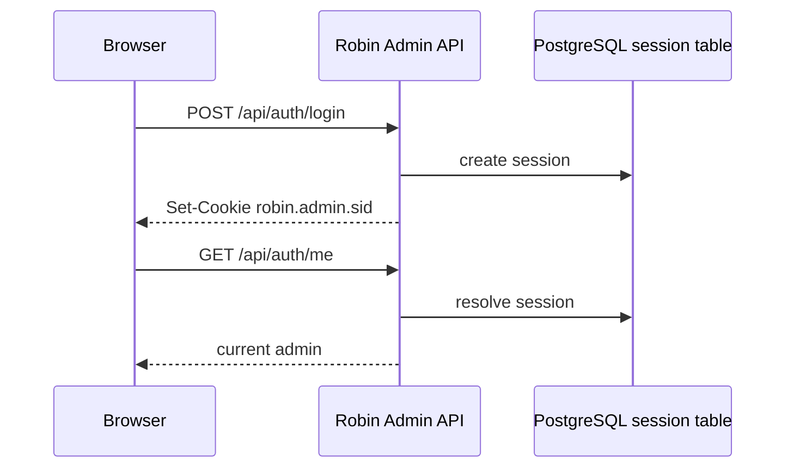

# Authentication

## Model

Robin Admin uses **server-side sessions** backed by PostgreSQL.

Login flow:

1. User submits email and password
2. Server validates the admin record
3. Password is verified with bcrypt
4. The server regenerates the session ID
5. A session is written to the PostgreSQL-backed session store
6. The browser receives the `robin.admin.sid` cookie
7. Subsequent browser requests use that cookie automatically
8. Unsafe browser writes include an `X-CSRF-Token` header

## Session storage

- Session middleware: `express-session`
- Store: `connect-pg-simple`
- Cookie name: `robin.admin.sid`
- Persistence: survives normal server restarts because the session data lives in PostgreSQL
- Policy: idle and absolute session lifetime are configurable in **Administration -> Security**



## Password security

- Passwords are hashed with bcrypt
- Minimum password length is enforced during first-admin setup and password changes
- Passwords are never stored in plain text
- Public self-service recovery sends a one-time email token that expires after
  30 minutes and is stored only as a hash.
- Token consumption, password replacement and session revocation are one
  database transaction. Concurrent requests cannot reuse the same token.
- Recovery emails use the configured `ROBIN_ADMIN_PUBLIC_URL`; they never build
  links from the inbound `Host` header.

### Local administrator password reset

Run the reset command on the Robin Admin host with database access. Supply the password through standard input (preferred) or the `ROBIN_ADMIN_NEW_PASSWORD` environment variable; it is never accepted as a command-line argument.

```bash
printf '%s\n' 'NewStrongPassword1' | npm --prefix server run admin:reset-password -- --email admin@example.com
```

The command applies the normal password policy, uses the existing bcrypt helper, invalidates active sessions and any active recovery tokens, and writes an audit entry.

## Health checks

- `GET /health/live` checks that the process is serving requests.
- `GET /health/ready` checks PostgreSQL and returns HTTP 503 while unavailable.

## Brute-force protection

Robin Admin stores login attempts in PostgreSQL and can lock accounts or IPs after repeated failures.

Configurable settings:

- Enable or disable persistent login protection
- Attempts per account
- Attempts per IP
- Lockout duration
- Manual lockout clearing for one email or all active lockouts

Account and IP lock thresholds are configured separately. Lockout duration also
defines the failed-attempt counting window.

Failed logins and lockouts are written to the audit log. Login errors intentionally avoid distinguishing disabled accounts from bad credentials.

## Login and logout

### Login

- `POST /api/auth/login`
- Returns the authenticated admin in `data`
- Establishes the server-side session
- Returns a CSRF token for browser writes

### Logout

- `POST /api/auth/logout`
- Destroys the current session
- Clears the session cookie

## Session checks

- `GET /api/auth/me` returns the current admin when the session is valid
- `GET /api/auth/csrf` returns the current session CSRF token
- The client uses this endpoint on initial load to restore auth state

## CSRF protection

Session-cookie authenticated writes require:

```text
X-CSRF-Token: <token from login or /api/auth/csrf>
```

CSRF checks apply to `POST`, `PUT`, `PATCH`, and `DELETE` requests made with the browser session cookie. Bearer API-key requests and report ingestion shared-secret requests do not use CSRF tokens.

The setting can be controlled from **Administration -> Security**.

## Automation API keys

Automations should use scoped API keys instead of browser sessions.

API keys:

- Are created and revoked from **Administration -> Access**
- Are stored only as SHA-256 hashes
- Are shown only once at creation
- Have a role ceiling: `viewer`, `editor`, or `admin`
- Have explicit scopes such as `metrics:read`, `queue:write`, `reports:ingest`, or `admin:*`
- Can expire
- Can be restricted to CIDR allowlists
- Track last-used time and IP address

Use API keys with:

```text
Authorization: Bearer <api-key>
```

Representative scopes:

| Scope | Purpose |
|-------|---------|
| `metrics:read` | Metrics and dashboard reads |
| `users:read` / `users:write` | Mailbox reads or writes |
| `aliases:read` / `aliases:write` | Alias reads or writes |
| `queue:read` / `queue:write` | Queue inspection and actions |
| `reporting:read` / `reporting:write` | Reporting intelligence reads and actions |
| `reports:read` | Raw report reads |
| `reports:ingest` | DMARC, TLSRPT, and forensic report ingestion |
| `telemetry:read` / `telemetry:write` / `telemetry:manage` | Telemetry reads, metric ingestion, and dashboard changes |
| `admin:*` | Admin-only settings and management APIs |

API keys still pass through role checks. For example, a key with an admin-only scope also needs an `admin` role ceiling for admin routes.

## IP restrictions

Robin Admin can enforce server-side CIDR restrictions:

- Global IP allowlist for all API access
- Per-administrator CIDR restrictions that further narrow browser-session access
- Per-API-key CIDR allowlists
- Ingestion source CIDR allowlist
- Trusted proxy CIDRs

When trusted proxy CIDRs are configured, Robin Admin only trusts `X-Forwarded-For` from a direct peer in those CIDRs. Otherwise it uses the direct socket IP. Global, trusted-proxy, and ingestion CIDR lists reject invalid entries when saved.

Administrator CIDRs are additive only: if both a global allowlist and per-admin CIDRs are configured, the request IP must satisfy both.

Browser-session idle timeout accepts 5-1440 minutes. Absolute lifetime accepts
5-10080 minutes and must be at least the idle timeout. CSRF protection applies
to cookie-authenticated unsafe methods; API-key requests are exempt.

## First admin setup

First-time setup is separate from login:

- `GET /api/setup/status`
- `POST /api/setup`

The setup wizard requires the setup ID logged by the server at startup. While
setup is pending, the same ID is also written to `SETUP_ID_FILE` (default
`/tmp/robin-admin-setup-id`) with `0600` permissions so a root user can retrieve
it without exposing it through the API.

## Bot ingestion endpoints

These endpoints do not require a browser admin session, but ingestion authentication is enabled by default:

- `POST /api/dmarc/reports`
- `POST /api/tlsrpt/reports`
- `POST /api/forensic/reports`

Accepted access methods:

1. Source IP matches **Administration -> Reporting -> Report ingestion -> Trusted ingestion source CIDRs**
2. `Authorization: Bearer <api-key>` with the `reports:ingest` scope
3. `X-Robin-Admin-Ingest-Secret: <shared-secret>` configured in **Administration -> Reporting -> Report ingestion**

No CIDR is trusted by default: the trusted-ingestion-CIDR list starts empty, so every producer must authenticate via an API key or shared secret until an operator explicitly opts a network in. For a co-located deployment where local Robin MTA/bot containers should post without extra secret distribution, add a starter list under **Administration -> Reporting -> Report ingestion -> Trusted ingestion source CIDRs**:

```text
127.0.0.0/8
::1/128
10.0.0.0/8
172.16.0.0/12
192.168.0.0/16
fc00::/7
```

These cover entire private address spaces, so only add them when the admin API is not reachable from broader private networks than the intended report producers; narrow the list otherwise.
