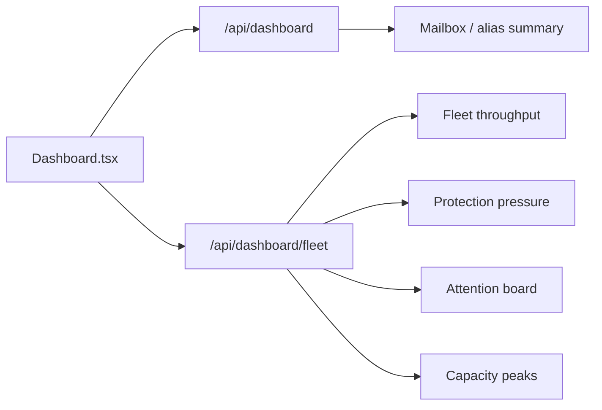

# Dashboard

The dashboard is a **fleet-first operational landing page**. It prioritizes live fleet activity, protection pressure, and which services need attention, rather than duplicating queue-specific detail.

## Data model

## Main sections

### Operational snapshot

Quick-link cards into the parts of the app operators open most often, alongside high-level mailbox/admin counters.

### Fleet throughput

Shows the current 24-hour fleet movement:

- received
- delivered
- rejected
- average memory / CPU
- at-risk service count
- top service by live activity

### Top services

Highlights the busiest services while still keeping unhealthy ones visible so the page remains operationally honest.

### Fleet attention

This area groups the operational signals that usually need attention first:

- **Protection pressure (24h)**: rejection mix across RBL, spam, virus, and DoS categories
- **Services needing attention**: the services most likely to need intervention first
- **Capacity peaks**: memory/CPU hot spots across enabled services

### Telemetry hosts

When Telemetry is on, a card counts the hosts that sent metrics in the last seven days as reporting or silent (no sample for 15 minutes), lists the silent ones and links to **Telemetry -> Sources**. Like other cards it can be hidden under **Customize**.

## Intentional product choices

- The dashboard **does not use queue composition** because that detail is service-local and can be misread as fleet-wide health.
- Queue detail still belongs on the **Queue** page.
- The page stays focused on current fleet health rather than duplicating queue detail.

## Refresh behavior

Dashboard data is fetched on load and refreshed when the page reloads; it is designed as a current operational snapshot, not a live streaming console.
