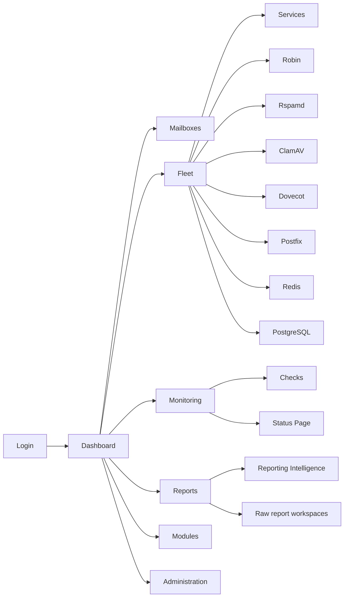

# Getting started

## Startup flow

When Robin Admin starts, it:

1. Connects to PostgreSQL
2. Initializes any missing schema
3. Seeds local module metadata from deployment config
4. Seeds setup state if no admin exists
5. Starts the metrics poller and API server

If no admin accounts exist, the UI redirects to the setup wizard.

## First-time setup

The first admin setup uses a server-side setup ID written to a local `0600`
file while setup is pending. The server also logs where the file was written:

```text
[SETUP] Setup ID file: /tmp/robin-admin-setup-id
```

Root can retrieve it with:

```bash
cat /tmp/robin-admin-setup-id
```

For the bundled Compose deployment:

```bash
docker exec suite-admin cat /tmp/robin-admin-setup-id
```

Set `SETUP_ID_FILE` to use a different server-local path.

Use that ID in the setup wizard together with:

1. Your admin email
2. A strong password

> **Security note**: The setup ID proves server access before the first admin account can be created.

## Authentication model

Robin Admin uses **session cookies** for browser users:

- login: `POST /api/auth/login`
- session check: `GET /api/auth/me`
- CSRF token: `GET /api/auth/csrf`
- logout: `POST /api/auth/logout`

Sessions are stored in PostgreSQL, so normal restarts do not invalidate them.

Unsafe browser writes require an `X-CSRF-Token` header. The React client handles this automatically.

Automations should use scoped API keys instead of browser sessions:

```text
Authorization: Bearer <api-key>
```

Create API keys in **Administration -> Access**.

## Initial security checklist

For an internet-facing deployment, review **Administration -> Security / Integrations / Reporting** after first login:

1. Set explicit allowed CORS origins for the admin UI.
2. Keep persistent brute-force protection enabled.
3. Set idle and absolute session lifetimes.
4. Configure a global IP allowlist if access should be limited to VPN or office networks.
5. Create scoped API keys for automations.
6. Review the trusted ingestion CIDRs in **Administration -> Reporting -> Report ingestion**. Fresh installs trust no source network without a report-ingestion credential until you add explicit CIDRs.
7. Rotate the shared ingestion secret in **Administration -> Reporting -> Report ingestion**, or use a `reports:ingest` API key for report bots outside trusted CIDRs.
8. Keep private fleet service URLs disabled unless the deployment network and egress rules make them safe.
9. If you want isolated Rspamd management, mount its `local.d` and store paths into `suite-admin`, verify the controller URL, and set the controller password under **Rspamd -> Rules** (the Controller card). It's the plaintext of the controller's `password` setting; Robin Admin sends it on privileged requests (`/stat`, `/healthy`, `/errors`, learning) and never shows it again, only whether one is set.
10. Decide which optional capabilities should be enabled in **Administration -> Integrations -> Capabilities**: Mailboxes, Fleet, Monitoring, and Modules are off on a clean install. Mailboxes remains visible when enabled even without Fleet mail services; each tab needs compatible mailbox tables in Admin's PostgreSQL database (see [Mailboxes](mailboxes.md)).
11. Enable **Reports** in `Administration -> Integrations -> Capabilities` when needed. If disabled, the **Reports** sidebar group and reporting workspaces are hidden without deleting stored reports or changing ingestion authentication.

## Navigation



### Sidebar groups

- **Dashboard**: fleet-first landing page
- **Mailboxes**: users, aliases, auto aliases
- **Fleet**: service registry, Metrics, and nested operational workspaces:
  - **Robin**: queue, delivery test, metrics, config, and logs
  - **Rspamd**: scan, training, DKIM keys, rules, metrics, config, and logs
  - **ClamAV**: scan, metrics, config, and logs
  - **Dovecot**: metrics (with sessions and quota tabs), config, and logs
  - **Postfix**: queue, metrics, config, and logs
  - **Redis / PostgreSQL**: metrics, config, operational controls, and conditional logs
- **Monitoring**: external checks, status-page management, and email-delivery monitoring
- **Reports**:
  - Intelligence: Overview, Sources, Domains, Explorer
  - Raw evidence: DMARC Raw, TLSRPT Raw, Forensic Raw
- **Modules**: local module catalog, runtime status, and license activation
- **Administration**: access, security, integrations, reporting, and activity log

Sidebar collapse state is persisted in localStorage under `robin-admin.sidebar.collapsed`; group expansion state is persisted under `sidebar-expanded-groups`.

## Roles

| Role | Typical access |
|------|----------------|
| **viewer** | Read-only visibility across the app |
| **editor** | Operational/reporting actions such as queue and reporting analysis workflows |
| **admin** | Full access including admin management, settings, and Robin config |

## Report bot authentication

DMARC, TLSRPT, and forensic ingestion endpoints require every source to authenticate by default. Every bot should send one of:

```text
Authorization: Bearer <api-key-with-reports:ingest>
```

or:

```text
X-Robin-Admin-Ingest-Secret: <shared-secret-from-settings>
```

For a co-located deployment, an operator can instead add trusted local/container
source CIDRs under **Administration -> Reporting** so those bots can post without
a credential — see [Authentication and security](authentication.md).

## Development defaults

- Frontend dev server: `http://localhost:5173`
- Backend API: `http://localhost:3000`
- HTTPS via Docker/Caddy: `https://localhost:3443`

## Standalone deployment

Robin Admin does not require a Robin MTA or Robin Sheriff to start, set up,
authenticate administrators, or manage its local configuration. Use a dedicated
PostgreSQL database and persistent volume for Robin Admin, then set
`ROBIN_API_ENABLED=false` when no MTA is connected. For an installation at a
reverse-proxy path such as `/admin`, see [Standalone deployment](standalone-deployment.md).

## Optional federated services

`robin-admin` starts independently from `robin-qa`, `robin-tools`, and `robin-sheriff`.

- Start `robin-qa` from `../robin-qa/docker-compose.yaml` to make the hosted QA
  frontend and `robin-qa-server` backend available.
- Start `robin-tools` from `../robin-tools/docker-compose.yaml` to make the hosted
  diagnostics frontend and `robin-tools-server` backend available.
- Start `robin-sheriff` from `../robin-sheriff/docker-compose.yaml` when you want to refresh the catalog or activate a paid module license.
- Robin Admin shows hosted module navigation only when the module runtime is reachable.
- The **Modules** page remains available even when a module is offline so operators can inspect status and enter a license key.
- Hosted modules inherit Robin Admin route navigation; they do not render a second in-module tab bar when hosted.
- Robin Admin proxies browser module API traffic to the sibling module backends; module frontends are mounted inside Shadow DOM hosts so module CSS stays isolated from Robin Admin and from other modules.

## Isolated Rspamd wiring

Robin Admin configures Rspamd per fleet service, independently of Robin:

- controller URL, password, and normal worker URL
- readable config mount (`local.d`)
- readable store mount

The default compose file wires these to:

```text
/mnt/rspamd/local.d
/mnt/rspamd/store
```

Override the host-side source paths with:

```text
RSPAMD_CONFIG_MOUNT=/host/path/to/rspamd/local.d
RSPAMD_STORE_MOUNT=/host/path/to/rspamd/store
```

Register the Rspamd service under **Fleet -> Services**, then set its controller
URL, credentials, and mounted paths. When the service is enabled, its workspace
appears under **Fleet -> Rspamd**. Read-only mounts keep supported views visible
but disable mutating actions.

## Fleet agent (bare-metal or remote hosts)

Robin Admin reaches most services directly (a URL/DSN, or a co-located socket).
Postfix and Dovecot are managed through their host tooling — metrics, queue
control, sessions, and reloads run via the `robin-agent` — and any service on a
host robin-admin can't reach directly needs the agent installed alongside it. The agent dials **out** to robin-admin, so it
works from a container, a bare-metal host, or a NAT'd remote host with no
inbound access.

Create one from **Fleet -> Agents**; the page generates a ready-to-run
enrollment command for systemd, Docker, Compose, or manual install. See the
[deployment guide](agent-deployment.md) and [co-location guide](agent-co-location.md)
for installation methods, environment variables, and per-service requirements.
