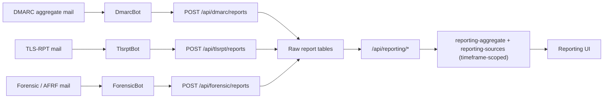

# Reports

Report ingestion payload size is configured in Administration > Report Ingestion.
The saved 1..20 MiB limit applies to new requests, including chunked and
decompressed JSON/form bodies. The default is 5 MiB. General request limits,
parser expansion limits and authentication remain separate safety boundaries.

The source reader folds canonical IPv4 addresses by their live provider,
verified PTR domain, or unknown network in PostgreSQL before transferring
counters to the API. Negative DNS cache entries do not disable network folding.
IPv6 aliases and unusual textual forms retain the live API fold. Address/domain counts and
taxonomy use complete sets, not the capped display samples. This adds no ingest
write, persisted materialization or additional index. Dense independently named
sources still require a wider read; query admission limits remain necessary.

`LOAD_SECONDS=3600 LOAD_AGENTS=3 node server/scripts/combined-load.mjs` exercises
100,000 addresses/10,000 live identities, eight report readers, report ingestion
and retention, three real agents, and 800 telemetry series on 80 hosts. Build
`robin-admin-server` from `server/` and `robin-agent:reliability` from `agent/`
first. The drill uses fresh labelled containers/databases, publishes only a
localhost control port, verifies exact totals and no OOM/restarts, then removes
only its own fixtures. It does not use live credentials or production data.
The Reliability drill workflow accepts the `combined` workload. Results are a
defined-workload capacity measurement, not a universal latency or leak guarantee.

Robin Admin treats reporting as two connected workspaces:

1. **Raw evidence** for RFC-level inspection of imported reports
2. **Reporting intelligence** for operator workflows and remediation

## Reporting pipeline



## Intelligence workspaces

The primary operator surfaces live under **Reports** in the sidebar. Raw evidence is
nested *underneath* Reports rather than beside it, because the raw browsers are the
appeal court for the derived views above them:

```
Reports
├── Overview     Fleet compliance, message-outcome taxonomy, what needs attention
├── Sources      THE core screen: every sending service, across all domains
├── Domains      Fleet conformance — which domains deviate from the fleet baseline
├── Explorer     Record-level, filterable evidence viewer with CSV export
└── Raw Data
    ├── DMARC Reports
    ├── TLSRPT Reports
    └── Forensic Reports
```

### The compliance taxonomy

Every screen speaks one vocabulary, implemented once in
`server/src/services/dmarc-taxonomy.ts` and mirrored in
`client/src/types/reporting.ts`:

| Class | Meaning |
|---|---|
| **DMARC compliant** | fully aligned, DKIM-aligned only, or SPF-aligned only |
| **Authenticated, not aligned** | DKIM or SPF valid, but for a domain other than the From |
| **Failed** | neither axis aligned |

Failures are sub-classified by the receiver's own RFC 7489 override reason
(forwarded / trusted forwarder / mailing list / sampled out / local policy / other).
Failures the receiver itself attributed to forwarding or a mailing list are counted as
**benign relay**; the remainder are **actionable failures**. This distinction matters:
on a large sending fleet the overwhelming majority of raw "failures" are forwarding,
and treating them as problems buries the handful that are real.

### The source model

The **source** — a sending service seen across every domain it sends for — is the core
object, not a per-(domain, IP) row and not a free-floating issue queue. IPs are grouped
by graceful degradation: known provider → registrable domain of a forward-confirmed PTR
→ network block (/24, /48) → single address. Only the first two count as *identified*.

Sources are classified into the four buckets every commercial DMARC product uses:

| Bucket | Meaning |
|---|---|
| **DMARC capable** | sending compliant mail; nothing to do |
| **Non-compliant** | recognised sender failing DMARC; this is the work |
| **Forwarders** | failing only because a receiver forwarded the message; benign |
| **Threat / Unknown** | failing, unidentified and unapproved; investigate |

Operators record a decision per source (authorised / forwarder / threat), and it applies
across every domain that source sends for.

### Timeframe

Every reporting endpoint takes an explicit `from`/`to`, and every screen persists it in
the URL. When absent, the server picks the window from the **actual extent of the data**
(`MAX(dmarc_reports.date_end)` backwards), never from `now()`, and reports back what it
chose along with the data's true age.

This keeps the default view tied to the reports Robin Admin actually holds instead of
showing an empty recent window as "all clear". Screens say which window they describe,
warn when the data is stale, and distinguish "no data in this window" from "no
problems in this window".

### The one-aggregate rule

`server/src/services/reporting-aggregate.ts` is the single timeframe-scoped aggregation
service. Overview, Sources, Domains and Explorer all read it, so a headline count is
always the length of the list beneath it and two screens cannot contradict each other.
Do not add a reporting query that computes its own window.

MTA-STS, DANE, and BIMI visibility is configurable in the reporting posture logic and
surfaced as explicit state instead of a generic pass/fail badge.

## Reports integration gate

Report-backed pages are controlled by **Enable Reports** in
**Administration -> Integrations -> Capabilities**. Report analysis, posture
checks and retention remain under **Administration -> Reporting**.

- When enabled, the full **Reports** sidebar group and reporting workspaces are available.
- When disabled, Reports navigation and workspaces are hidden. Stored reports,
  ingestion authentication, and report-ingestion endpoints remain unchanged.

## Bulk checks from reporting pages

Robin Admin exposes check primitives through the reporting pages:

- **Sources** can re-run IP-to-service identification (PTR + FCrDNS + provider catalogue)
  for every source in view via *Identify sources*.

## Raw evidence workspaces

The raw pages remain available for evidence drill-down:

- **DMARC Raw**
- **TLSRPT Raw**
- **Forensic Raw**

The raw workspaces provide:

- server-side sorting
- persistent filter state
- items-per-page controls
- chart and summary cards above the table
- richer detail modals for evidence inspection

## DMARC raw

DMARC aggregate reports are stored in:

- `dmarc_reports`
- `dmarc_records`

Key evidence preserved in the raw tables includes:

- reporting organization and report ID
- policy window (`date_begin`, `date_end`)
- policy metadata (`policy`, `subdomain_policy`, alignment settings, `pct`)
- per-source records with SPF/DKIM/disposition outcomes

Reports arrive through Robin's **DmarcBot**, which posts to `POST /api/dmarc/reports`.

## TLS-RPT raw

TLS-RPT reports are stored in:

- `tlsrpt_reports`
- `tlsrpt_policies`
- `tlsrpt_failures`

Policy types supported by the raw model:

- `sts`
- `tlsa`
- `no-policy-found`

The raw workspace is built to show:

- policy-level success/failure totals
- failure-detail groupings
- reporting-domain coverage
- empty-state guidance when no TLS reports have been imported yet

Reports arrive through Robin's **TlsrptBot**, which posts to `POST /api/tlsrpt/reports`.

## Forensic raw

Forensic / AFRF reports are stored in `forensic_reports`.

The raw workspace focuses on:

- feedback type and auth failure category
- source IP and reported domain
- `Authentication-Results`
- original headers and subject evidence where present

Reports arrive through Robin's **ForensicBot**, which posts to `POST /api/forensic/reports`.

## Data lifecycle

- Report ingestion stores normalized raw evidence.
- Reporting requests resolve an explicit or data-relative timeframe.
- The shared aggregate derives overview, source, domain, and record views for
  that timeframe.
- Source reviews persist operator classifications without changing raw evidence.
- Source resolution can refresh PTR, FCrDNS, and provider identification.

## Capacity validation

### Rebuilding retained history

`npm run rollups:backfill` in `server` atomically replaces only days with retained
raw reports. Days with no raw reports are preserved, including gaps inside the
retained range. Missing report contributions, orphaned records, or original
payload record-count mismatches cause a refusal before any rollup change. Raw
reports without original payload record counts cannot be safely rebuilt.

Run during a quiet maintenance window with a backup: raw writes and retention
wait for the rebuild transaction. Lock acquisition times out after five seconds;
individual statements time out after thirty minutes. Overlapping rebuilds are
refused. Any failure rolls back all rebuilt days. Retired raw evidence cannot
be reconstructed from aggregates; restore a complete backup when it is needed.
Completeness checks detect missing evidence, not every possible out-of-band
database edit. Do not manually delete or alter raw reports/records to repair data.

### Measuring capacity

Aggregate reads use daily rollups; their cost follows the selected date range and
domain/source cardinality, not just raw record count. Canonical IPv4 service
groups are folded before transfer; the API merges remaining address forms.
Very large address sets still add database and identity-read CPU/transfer work.
Cached reads do not establish uncached capacity.

Only completed service folds are cached, keyed by UTC-day window, scope and a
stable fingerprint of live identities. Per-address counter rows are transient:
a fold cache hit does not fetch or retain them. Reviews and classification
settings are applied live on every request. Domain counts use the complete union
before display samples are capped. Live identity reads use the selected rollup
window and scope, without transferring every unresolved address into an SQL
parameter. Adding, changing or removing an identity refreshes grouping on the
next read; textual IPv6 aliases choose the latest resolved cache row with a
deterministic address tie-break. This avoids caching operator decisions or stale
identity metadata. An identity change requires a new aggregation, not just a
metadata patch to an old fold.
Unnamed canonical IPv4 networks transfer only the identity of their display
representative, selected across every address in scope, including uncached
addresses. A later cached address cannot supply that representative's metadata.
Named identities and noncanonical address forms remain available for grouping;
canonical cache entries referenced by textual aliases are retained too. Editing
a nonrepresentative negative DNS answer does not invalidate an unchanged display
fold; identifying that address or editing the displayed representative does.
Windows without canonical IPv4 negative-cache rows skip representative scans.
The existence probe selects a live query plan; it does not cache identity state.
Report ingest/replacement becomes visible in aggregates within the 30-second
invalidation window; already-running readers can finish their earlier result.
Rollup cache keys use the same UTC-day bounds as their SQL: changing only the
time of day or view metadata shares the computation. Raw record queries retain
their exact timestamp bounds. Omitted, null and empty scope filters share the
unfiltered key; domain/reporter casing matches SQL normalization. Different days,
effective scopes and filters remain separate.
Separate reads are not a cross-screen transactional snapshot. Completed aggregate
and source-fold caches share a structural memory budget (default 128 MiB) and
entry limit (default 200), evicting least-recently-used results. Oversized results are returned but
not retained. In-flight identical computations share work until completion;
invalidation lets new readers compute fresh data. The estimate is not an exact
V8 heap or process RSS bound, and excludes active requests and other services.
Transient normalized source rows share equal sorted domain sets without capping
domain counts or changing taxonomy. Only sampled completed folds contribute to
the retained cache estimate. Many distinct service groups can still exhaust that
budget; fewer groups do not make the initial per-address aggregation free.
Source processing yields between chunks and accumulates taxonomy directly into
service totals, reducing temporary objects and contention with other requests.

Source reads (including Overview and domain workspaces) use two active slots and
at most eight waiting requests per Admin process. A queue wait over 30 seconds or
a full queue returns HTTP 503 with `Retry-After: 1`. Slots cover SQL, live identity
and review reads, folding and pagination. A disconnected browser does not cancel
accepted work; running database statements retain their configured timeout.
This is a single-process limit, not coordination between replicas. High-cardinality
windows still require adequate memory and measured deployment capacity.

Administration -> Reporting -> Analysis owns these persisted, audited resource
policies: cache budget 16..1024 MiB, 10..1000 entries, lifetime 5..900 seconds;
source concurrency 1..8, waiting queue 0..128, wait 1000..120000 ms. Defaults are
128 MiB / 200 / 300 seconds and 2 / 8 / 30000 ms. Changes apply without restart.
Decreases trim completed cache entries immediately and can shorten existing
lifetimes; increases do not extend already cached lifetimes. Accepted active
reads finish, and already queued reads keep their original wait deadline.
Queue increases drain FIFO; lowering concurrency delays new admissions until
active reads finish. These are application limits, not database/container or RSS
limits. Increasing them can increase memory and CPU contention rather than
improve latency. Ingest invalidation remains bounded to 30 seconds.

The scale harness is destructive and refuses non-disposable targets. Use an
isolated database named `robin_release_scale` (or `robin_release_scale_<suffix>`)
with `SCALE_HARNESS_DISPOSABLE=1`, then run `npm run rollups:scale-harness` in
`server`. `REPORTS`, `RECS_PER_REPORT`, `DOMAINS`, `REPORTERS`, `DAYS` and optional
`SOURCES` control raw volume and rollup cardinality. It checks raw/rollup parity,
refreshes rollup statistics, checks aggregate plans, and prints application-cache-
cold and warm timings. It does not flush PostgreSQL or operating-system caches.
Refresh database statistics after large backfills and measure on deployment-like
hardware before setting a capacity or latency guarantee.

The initial 500 ms harness target is not a universal latency guarantee. A
100,000-address fixture can exceed it even at one million raw records: Domains
and Sources also aggregate source-grain rollups. Use narrower timeframes and
deployment-like cardinality tests when sizing larger installations. Warm results
and fixed-cardinality 10-million-record tests must not be used to promise
subsecond reads for every source distribution.

### Reference workload

A local synthetic check on 2026-10-02 used one million raw records, 300,000
source-rollup rows, 100,000 addresses and 200 domains, folded into about 393
source groups. The Admin container ran Node 22 with a 1 GiB memory limit and
1.5 CPUs; PostgreSQL and VictoriaMetrics ran separately. These are observations,
not an SLA or a maximum supported fleet size.

Before the fold-only cache refactor, read-only Sources p95 was about 1.7 seconds
for one application-cache-cold reader
and 11.1 seconds for eight readers requesting distinct day windows. Warm p95 was
about 204 ms and 1.34 seconds respectively. The short repeated run sampled up to
366 MiB process RSS; the retained fixture and totals were unchanged.

A separate five-minute full-API run combined eight distinct source readers,
report ingest/analysis, raw retention, and telemetry ingest/query/panel requests
for 80 synthetic hosts and 800 time series. It accepted all 157,600 telemetry
samples without rejected writes or HTTP errors, preserved exact rollup totals,
and sampled 401 MiB peak Admin RSS. Sources p95 was 12.9 seconds; telemetry panel
p95 was 1.55 seconds and ingest p95 was 1.93 seconds. The effective telemetry
ingest rate was about 525 samples/second, not the producer's nominal send rate.

A separate same-day fold-cache comparison used the retained 100,001-address,
392-group fixture, Node 22.22.2 and the same 1 GiB / 1.5 CPU limits. Complete
page results matched before and after, including samples, taxonomy, rates and
bucket counts. One window retained about 1.57 MiB instead of 73.12 MiB of estimated
cache memory; eight windows retained 12.53 MiB without evicting one another.
Eight repeated distinct-window reads completed in 37..42 ms instead of
10.72..10.86 seconds, which previously recomputed after cache eviction. These are
service-call batch timings including verification serialization, not HTTP/browser
latencies. Single cold reads remained 1.27..2.14 seconds and eight cold reads
8.87..9.87 seconds: the 500 ms cold target is still unmet. PostgreSQL/OS caches
were not flushed, and the short local sample does not establish tail latency.

The same comparison with 10,000 distinct provider groups retained 15.18 MiB per
window instead of 22.35 MiB. Four windows used 60.72 MiB instead of 89.39 MiB.
Live identity lookup, hashing, classification and sorting still cost work on a
cache hit; these dense reads showed no consistent latency improvement and had
variable hundreds-of-milliseconds timings. A mostly unresolved, highly grouped
fixture must not be used to promise equivalent speed with many resolved groups.
No database schema, ingest path or resource-policy default changed in this
cache refactor.

These checks do not prove long-running leak freedom, a busy real Fleet/Monitoring
deployment, 100,000 independently displayed source groups, or arbitrary telemetry
cardinality. Sustained cold reads still compete for CPU and database work; narrow
the selected range/scope or measure additional resources before promising lower
latency. A 1 GiB Admin limit is not a 1 GiB budget for the complete stack.
